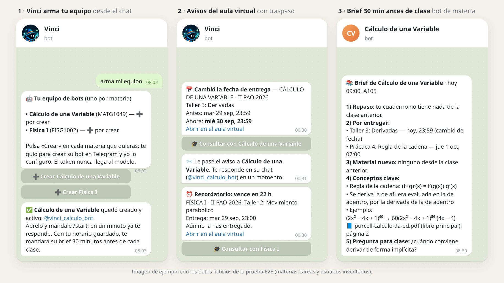

<div align="center">


# Vinci

**Tu semestre en ESPOL, en un chat.**<br>
Vinci lee tu aula virtual, te avisa antes de que algo se te pase<br>
y te ayuda a estudiar por Telegram y WhatsApp.


[Qué hace](#qué-hace) · [Empezar](#empezar) · [Guías](#guías) · [Privacidad](#privacidad)

</div>

<br>

<p align="center">
  
</p>
<p align="center"><sub>Datos ficticios de la prueba E2E.</sub></p>

## Qué hace

|   |   |
|---|---|
| 🔔 **Te avisa** | Revisa el aula cada 30 minutos: tareas nuevas, cambios de fecha, anuncios y notas. Te recuerda cada entrega 24 h y 3 h antes. |
| ☀️ **Te ordena el día** | A las 7:00 te manda tu semana: primero lo que vence, después lo que más pesa en tu nota. |
| 🤖 **Un bot por materia** | «Arma mi equipo» y tienes un bot para cada materia, con un repaso 30 minutos antes de cada clase. |
| 📚 **Estudia contigo** | Explica, resume y te hace `/quiz` con el material del curso, citando archivo y página. |
| 📊 **Saca tus cuentas** | «¿Cuánto necesito para pasar?» con los pesos del sílabo. Las cuentas las hace un script, no la IA. |
| 🎓 **Lee tu Académico** | Promedio, materias aprobadas y horarios de exámenes, sin guardar tu contraseña. |
| 📤 **Entrega por ti** | Fotos de tu deber hecho a mano → un PDF → «📤 Entregar». Nada se entrega sin tu toque. |
| 💬 **También en WhatsApp** | Tu chat, tus grupos y un Vinci propio para cada amigo. Entiende notas de voz. |

Todo corre en tu PC y solo te contesta a ti. Lo automático (revisar el aula, avisar, recordar) no usa la IA ni
gasta tokens. [Todas las funciones →](docs/guia/funciones.md#qué-hace-vinci)

## Empezar

Necesitas una PC con Linux que quede encendida, [Hermes Agent](https://github.com/NousResearch/hermes-agent) y
tu cuenta del aula virtual.

```bash
git clone https://github.com/SebasB76/vinci.git && cd vinci
./setup.sh                 # instala todo y crea secrets.env
nano secrets.env           # tu token del aula, el bot de Vinci y tu ID de Telegram
                           # en Telegram: mándale /start a tu bot nuevo
./setup.sh                 # configura Vinci y te manda un mensaje de prueba
hermes gateway install && hermes gateway start
```

Después, en Telegram, escríbele a Vinci **«arma mi equipo»** y mándale una captura de tu horario.
La [instalación paso a paso](docs/guia/instalacion.md#paso-a-paso) explica de dónde sale cada token.

## Guías

| | |
|---|---|
| [Instalación](docs/guia/instalacion.md) | Paso a paso, configuración, actualizar y desinstalar |
| [Uso diario](docs/guia/uso.md) | Vinci, los bots de materia, botones, comandos, `/token`, el Académico |
| [WhatsApp](docs/guia/whatsapp.md) | Vincular el número, grupos, amigos y el relé |
| [Todas las funciones](docs/guia/funciones.md) | Cada función en detalle |
| [Cómo funciona](docs/guia/como-funciona.md) | Hermes, el sondeo, la renovación del token y el repositorio |
| [Terminal y Claude Code](docs/guia/terminal.md) | El comando `aula` y `espol-bot` |
| [Privacidad](docs/guia/privacidad.md) | Qué guarda, qué sale de tu PC y qué puede hacer cada bot |
| [Límites y problemas](docs/guia/problemas.md) | Lo que todavía no hace y cómo arreglar lo común |
| [Contribuir](docs/guia/contribuir.md) | Hoja de ruta, la prueba E2E y `vinci-check` |

## Privacidad

- 🔒 **Solo lee tu aula.** Lo único que escribe es una entrega que tú confirmaste.
- 🏠 **Tus datos se quedan en tu PC.** No hay servidor de Vinci.
- 🔑 **Los tokens y tu contraseña nunca pasan por el chat ni por la IA.** Viajan cifrados.

[Qué sale de tu PC y por qué →](docs/guia/privacidad.md#seguridad-y-privacidad)

---

<sub>
<b>In English:</b> a self-hosted Telegram and WhatsApp assistant for ESPOL students, built on Hermes Agent.
It reads your Canvas courses, sends alerts and reminders, and creates one study bot per subject.
</sub>
<br><br>
<sub>
Proyecto independiente, sin afiliación a ESPOL, Instructure, Nous Research, Telegram ni WhatsApp.
Todavía sin licencia: pide permiso antes de reutilizar el código.
Gracias a <a href="https://github.com/NousResearch/hermes-agent">Hermes Agent</a>,
<a href="https://www.instructure.com/canvas">Canvas LMS</a> y la
<a href="https://core.telegram.org/bots/api">Bot API de Telegram</a>.
</sub>
