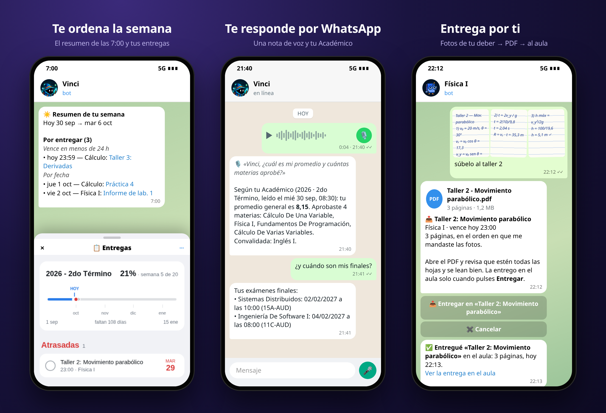

<div align="center">


# Vinci

**Tu semestre en ESPOL, en un chat.**<br>
Vinci lee tu aula virtual, te avisa antes de que algo se te pase<br>
y te ayuda a estudiar por Telegram y WhatsApp.


[Qué hace](#qué-hace) · [ESPOL](#conectado-a-espol) · [Empezar](#empezar) · [Guías](#guías) · [Privacidad](#privacidad)

</div>

<br>

<p align="center">
  
</p>
<p align="center"><sub>Datos ficticios, con los mensajes que los bots mandan en la prueba E2E.</sub>
</p>

## Qué hace

**Te mantiene al día**
- **Avisos del aula.** Revisa el aula cada 10 minutos: tareas nuevas, cambios de fecha, anuncios, notas y material. Si es un cuestionario, te dice cuántas preguntas tiene y cuánto tiempo dura.
- **Recordatorios.** Cada entrega pendiente, 24 h y 3 h antes. Si la entregaste en papel, pulsas «Ya lo entregué» y no insiste más.
- **Resumen de las 7:00.** Tu semana en orden: primero lo que vence, después lo que más pesa en tu nota.
- **Dashboard de entregas.** Una página dentro del chat con lo atrasado, lo de hoy y lo de la semana. Marcas una entrega con un toque.
- **Tu lista de pendientes.** «Anota: estudiar el capítulo 3 para el viernes» y te lo recuerda como una tarea más.

**Estudia contigo**
- **Todas tus materias en un chat.** Vinci sabe de qué materia hablas y te manda un repaso 30 minutos antes de cada clase. Con Telegram encendido, hay además un bot por materia.
- **Preguntas sobre el material.** Explica, resume y te hace preguntas tipo examen, citando archivo, página y el enlace del aula. Cada cita se comprueba antes de enviarse.
- **`/quiz`.** Un quiz corto en encuestas, con tu puntaje al final. Lo que fallas queda como tema débil.
- **Exámenes anteriores.** Busca en DSpace los parciales de tu materia y te resuelve uno pregunta por pregunta.
- **Cuaderno de cada materia.** Le cuentas lo que vieron, o le mandas una foto de la pizarra o una nota de voz, y lo guarda con un resumen.
- **Tus apuntes de clase.** Escribe `//vinci <pregunta>` en tus notas y Vinci te contesta en el chat.
- **Diapositivas.** «Hazme unas diapositivas de integrales dobles» y te manda el `.pptx`.
- **PDFs escaneados.** Lee con OCR las fotocopias, para que la búsqueda también las encuentre.

**Saca tus cuentas**
- **Calculadora de notas.** «¿Cuánto necesito para pasar?», con los pesos del sílabo. Las cuentas las hace un script, no la IA.
- **Tu Académico.** Promedio, avance de la carrera, materias aprobadas y horarios de exámenes, sin guardar tu contraseña.
- **Horario desde una captura.** Le mandas una captura de tu horario y lo entiende solo.

**Hace por ti**
- **Entrega a mano.** Fotos de tu deber, después un PDF, y lo entrega en el aula cuando pulsas «Entregar».
- **Planes de estudio.** Vinci ve todas tus materias, entregas y clases juntas, y arma un plan para el parcial.

**Donde estés**
- **WhatsApp.** Tu chat, tus grupos y un Vinci propio para cada amigo, con su aula. Entiende notas de voz. Telegram queda como opción (`channels.telegram`).
- **Terminal y Claude Code.** El comando `aula` consulta todo, y una skill le enseña a Claude Code a usarlo.
- **Estado y token desde el chat.** `/estado` te dice si todo está sano, y `/token` renueva el acceso al aula sin que el token pase por el chat.

Todo corre en tu PC y solo te contesta a ti. Lo automático (revisar el aula, avisar, recordar) no usa la IA ni
gasta tokens. [Cada función en detalle →](docs/guia/funciones.md#qué-hace-vinci)

## Conectado a ESPOL

Vinci lee lo que ESPOL ya tiene sobre ti, desde un solo chat:

| Fuente | Qué lee |
|---|---|
| **[Aula virtual](https://aulavirtual.espol.edu.ec)** (Canvas) | Tareas, fechas, anuncios, notas y el material de cada curso. También entrega tus deberes hechos a mano. |
| **[Académico](https://www.academico.espol.edu.ec)** | Promedio, avance de la carrera, historial, calificaciones y horarios de clases y exámenes. |
| **[DSpace](https://www.dspace.espol.edu.ec)** | Unos 20 000 exámenes anteriores de todas las facultades, que Vinci busca y resuelve. |

Y se vienen más.

## Empezar

Vinci corre sobre [Hermes Agent](https://github.com/NousResearch/hermes-agent). Solo necesitas tu cuenta de
ESPOL y unos minutos.

```bash
git clone https://github.com/SebasB76/vinci.git && cd vinci
./setup.sh                 # instala todo y crea secrets.env
nano secrets.env           # tu token del aula, el bot de Vinci y tu ID de Telegram
                           # en Telegram: mándale /start a tu bot nuevo
./setup.sh                 # configura Vinci y te manda un mensaje de prueba
hermes gateway install && hermes gateway start
```

Después, en Telegram, escríbele a Vinci **«arma mi equipo»** y mándale una captura de tu horario.
La [instalación paso a paso](docs/guia/instalacion.md#paso-a-paso) explica de dónde sale cada token.

## Guías

| Guía | Qué tiene |
|---|---|
| [Instalación](docs/guia/instalacion.md) | Paso a paso, configuración, actualizar y desinstalar |
| [Uso diario](docs/guia/uso.md) | Vinci, los bots de materia, botones, comandos, `/token`, el Académico |
| [WhatsApp](docs/guia/whatsapp.md) | Vincular el número, grupos, amigos y el relé |
| [En un servidor](docs/guia/servidor.md) | Vinci en Coolify con Docker, y cómo pasar tu Vinci de la PC al servidor |
| [Todas las funciones](docs/guia/funciones.md) | Cada función en detalle |
| [Cómo funciona](docs/guia/como-funciona.md) | Hermes, el sondeo, la renovación del token y el repositorio |
| [Terminal y Claude Code](docs/guia/terminal.md) | El comando `aula` y `espol-bot` |
| [Privacidad](docs/guia/privacidad.md) | Qué guarda, qué sale de tu PC y qué puede hacer cada bot |
| [Límites y problemas](docs/guia/problemas.md) | Lo que todavía no hace y cómo arreglar lo común |
| [Contribuir](docs/guia/contribuir.md) | Hoja de ruta, la prueba E2E y `vinci-check` |

## Privacidad

- **Solo lee tu aula.** Lo único que escribe es una entrega que tú confirmaste.
- **Tus datos se quedan en tu PC**, o en tu propio servidor. No hay un servidor central de Vinci.
- **Los tokens y tu contraseña nunca pasan por el chat ni por la IA.** Viajan cifrados.

[Qué sale de tu PC y por qué →](docs/guia/privacidad.md#seguridad-y-privacidad)

---

<sub>
<b>In English:</b> a self-hosted Telegram and WhatsApp assistant for ESPOL students, built on Hermes Agent.
It reads your Canvas courses, sends alerts and reminders, and creates one study bot per subject.
</sub>
<br><br>
<sub>
Proyecto independiente, sin afiliación a ESPOL, Instructure, Nous Research, Telegram ni WhatsApp.
Todavía sin licencia: pide permiso antes de reutilizar el código.
Gracias a <a href="https://github.com/NousResearch/hermes-agent">Hermes Agent</a>,
<a href="https://www.instructure.com/canvas">Canvas LMS</a> y la
<a href="https://core.telegram.org/bots/api">Bot API de Telegram</a>.
</sub>
