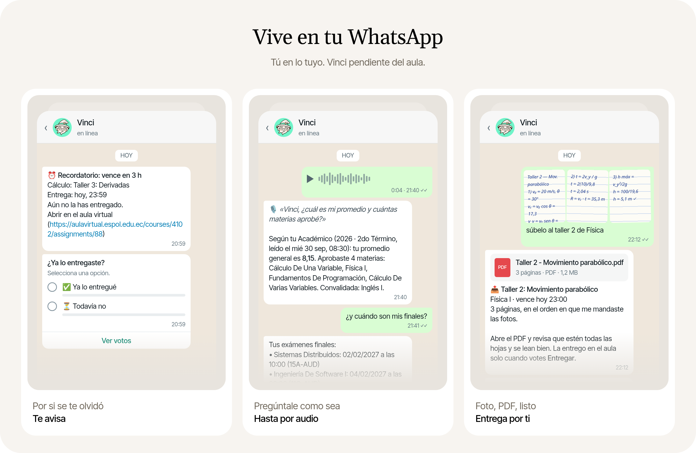

# Vinci

Tu aula virtual, pero en WhatsApp. 
Para estudiantes de ESPOL. Sin apps nuevas, sin drama.

 

  

Datos ficticios.

## Qué hace

Lee tu aula cada 10 minutos y te escribe cuando hay algo: una tarea nueva, un cambio de fecha, una nota.
Antes de que algo venza, te recuerda. Dos veces.

- A las 7:00 te manda la semana en orden. `/entregas` la abre en una página.
- Media hora antes de cada clase, te cuenta qué toca.
- Le preguntas por tu material y te contesta citando la página. También te toma quiz y busca exámenes anteriores.
- ¿Cuánto necesitas para pasar? Hace la cuenta con los pesos del sílabo. Tu promedio y tus horarios los saca del
  Académico.
- Le mandas fotos del deber, arma el PDF y lo entrega en el aula. Solo si le dices que sí.
- Entiende audios, capturas y fotos de la pizarra. También en grupos.
- Tus amigos pueden tener el suyo, cada uno con su aula.

Lo de revisar y recordar no usa IA, así que no gasta tokens. [Todo lo demás →](docs/guia/funciones.md#qué-hace-vinci)

## De dónde lee

- **[Aula virtual](https://aulavirtual.espol.edu.ec):** tareas, fechas, anuncios, notas y material. Ahí también entrega.
- **[Académico](https://www.academico.espol.edu.ec):** promedio, avance, historial y horarios de clases y exámenes.
- **[DSpace](https://www.dspace.espol.edu.ec):** unos 20 000 exámenes anteriores, de todas las facultades.

## Empezar

**¿Alguien ya tiene Vinci?** Que te agregue como amigo. Te llega un link, conectas tu aula y ya.

**¿Quieres el tuyo?** Corre en tu servidor con Docker. En [Coolify](https://coolify.io) son tres pasos:

1. Crea una app desde este repo, con el `Dockerfile` y un volumen en `/opt/data`.
2. Pon la key de tu proveedor de IA, tu token del aula y tu número de WhatsApp.
3. Dale a **Deploy** y vincula el número de Vinci.

[Paso a paso →](docs/guia/servidor.md#crear-la-app) · [Sin Docker →](docs/guia/servidor.md#en-una-laptop-vieja-en-casa-sin-docker)

## Privacidad

Solo lee tu aula. Lo único que escribe es una entrega que tú aprobaste. Tus datos se quedan en tu servidor, y tus
tokens y tu contraseña viajan cifrados: nunca pasan por el chat ni por la IA. [Los detalles →](docs/guia/privacidad.md#seguridad-y-privacidad)

## Más

[WhatsApp](docs/guia/whatsapp.md) · [Uso diario](docs/guia/uso.md) · [Funciones](docs/guia/funciones.md) ·
[Servidor](docs/guia/servidor.md) · [Instalación](docs/guia/instalacion.md) · [Privacidad](docs/guia/privacidad.md) ·
[Problemas](docs/guia/problemas.md) · [Cómo funciona](docs/guia/como-funciona.md) ·
[Terminal](docs/guia/terminal.md) · [Contribuir](docs/guia/contribuir.md)

---

<b>In English:</b> a self-hosted WhatsApp study assistant for ESPOL students, built on
<a href="https://github.com/NousResearch/hermes-agent">Hermes Agent</a>. It reads your Canvas courses, reminds you
before deadlines, answers questions about your course material and hands in your work.

  

Proyecto independiente, sin afiliación a ESPOL, Instructure, Nous Research ni WhatsApp.
Sin licencia todavía: pregunta antes de reusar el código.

