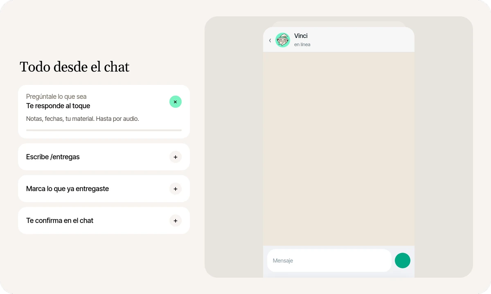

# Vinci

Tu aula virtual, pero en WhatsApp. 
Sin apps nuevas, sin drama.

 

  

.

## Qué hace

- Te avisa antes de que algo venza.
- Cada mañana te arma la semana.
- Te prepara para cada clase.
- Responde sobre tu material, con la fuente.
- Te dice cuánto necesitas para pasar, materia por materia.
- Te regala sobres de cartas por entregar a tiempo y por tus buenas notas.
- Entrega tus deberes desde unas fotos.
- Entiende audios, capturas y fotos de la pizarra.

[Todo lo que hace →](docs/guia/funciones.md#qué-hace-vinci)

## De dónde lee

- **[Aula virtual](https://aulavirtual.espol.edu.ec):** tareas, fechas, anuncios, notas y material. Ahí también entrega.
- **[Académico](https://www.academico.espol.edu.ec):** promedio, avance, historial y horarios de clases y exámenes.
- **[DSpace](https://www.dspace.espol.edu.ec):** unos 20 000 exámenes anteriores, de todas las facultades.

## Privacidad

Solo lee tu aula, y solo entrega lo que tú apruebas. Tus datos se quedan en tu servidor.
[Los detalles →](docs/guia/privacidad.md#seguridad-y-privacidad)

## Más

[WhatsApp](docs/guia/whatsapp.md) · [Uso diario](docs/guia/uso.md) · [Funciones](docs/guia/funciones.md) ·
[Servidor](docs/guia/servidor.md) · [Instalación](docs/guia/instalacion.md) · [Privacidad](docs/guia/privacidad.md) ·
[Problemas](docs/guia/problemas.md) · [Cómo funciona](docs/guia/como-funciona.md) ·
[Terminal](docs/guia/terminal.md) · [Contribuir](docs/guia/contribuir.md)

---

<b>In English:</b> a self-hosted WhatsApp study assistant for your Canvas courses, built on
<a href="https://github.com/NousResearch/hermes-agent">Hermes Agent</a>. It reads your Canvas courses, reminds you
before deadlines, answers questions about your course material and hands in your work.

  

Proyecto independiente, sin afiliación a ESPOL, Instructure, Nous Research ni WhatsApp.
Sin licencia todavía: pregunta antes de reusar el código.

