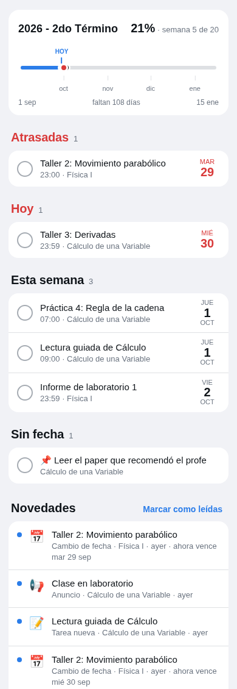
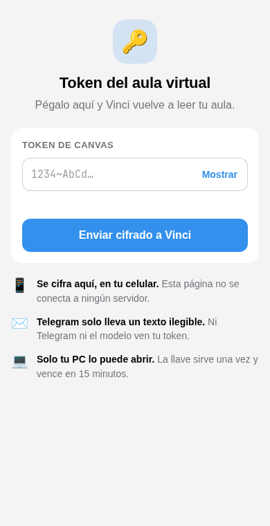
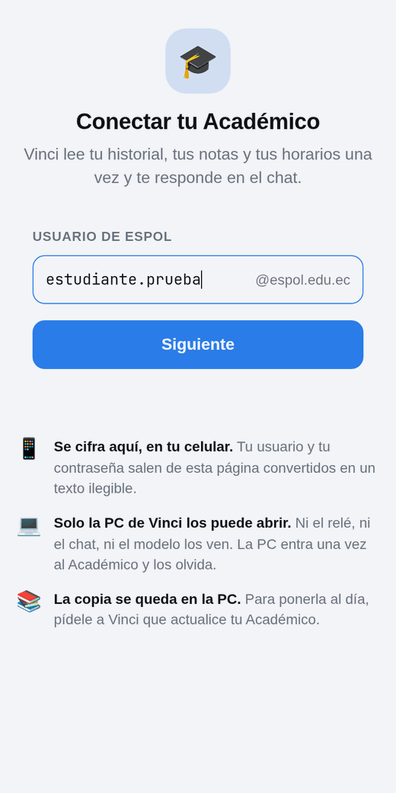
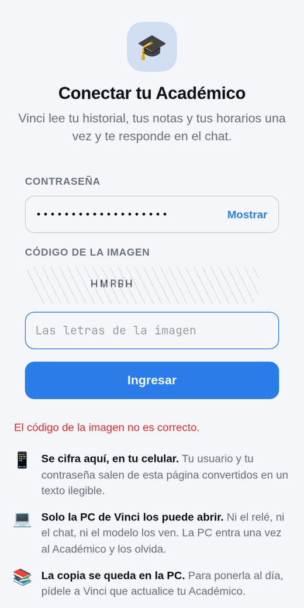

# Uso diario en Telegram

## Con Vinci

- «¿Qué tengo pendiente esta semana y en qué orden lo hago?» · «¿Cómo voy en todo?» · «Hazme un plan para el
  parcial de Física».
- «¿Qué dijo el profe de Cálculo?» · «¿Qué notas me publicaron?»
- «¿Cómo voy en notas?» · «¿Cuánto necesito para pasar Estadística?» · «En Física no hay examen en el primer
  parcial: todo son deberes y laboratorio» → te muestra el esquema para que lo guardes.
- «Tengo esto de Física» + una foto, un PDF o una nota de voz → te dice a qué bot se lo pasó. Si no le queda
  claro de qué materia es, te pregunta antes.
- «¿Qué hay en el cuaderno de Cálculo?» (Vinci lee los cuadernos, pero no los cambia).
- «El libro de Física es el Serway» → lo guarda como libro principal de esa materia.
- «Anota: estudiar cap. 3 de Física para el viernes» · «recuérdame llevar el certificado a secretaría mañana a
  las 10» → lo agrega a tu lista, con una tarjeta y su botón «✅ Hecho».
- Responde a un aviso con «pásaselo al de la materia», o pulsa su botón «🎓 Consultar con …».
- `/quiz derivadas de Cálculo` → se lo pasa al bot de Cálculo, que te manda el quiz en su chat. Si no dices de qué
  materia y el tema no lo deja claro, te pregunta.
- «Arma mi equipo» · «archiva el bot de Física» · «reactiva el bot de Física».

## Con cada bot de materia

Escríbele directo, como a un compañero que se sabe la materia:

- «Hoy vimos la regla de la cadena» → lo anota en su cuaderno como lo visto en clase.
- Una foto de la pizarra o una nota de voz → la guarda en el cuaderno con un resumen (y la transcripción, si es
  audio).
- «No entendí las derivadas implícitas» → te lo explica con el material del curso y lo anota como duda.
- «¿Qué dice el material de la regla de la cadena?» → te lo explica citando «📄 Capítulo 3 - Derivadas.pdf,
  página 2» con su enlace del aula; si preguntas por algo que el material no trae, empieza con «No está en el
  material» ([cómo se revisan las citas](#citas-que-puedes-comprobar)).
- «Explícame el capítulo 3» · «Hazme 5 preguntas tipo examen».
- `/quiz regla de la cadena` → un quiz corto en el chat: tocas la opción, Telegram te dice si acertaste y te
  muestra la explicación con la cita del material. `/quiz` solo te pregunta el tema; también puedes mandarle
  justo después el material (un texto, una foto o un PDF) y el quiz sale de eso.
- «¿Cómo voy en la materia?» · «¿Y si saco 70 en la lección?» · «Saqué 16/20 en la lección de ayer» (una nota que
  no está en el aula).
- «El libro principal es el Purcell», o el PDF del libro → lo usa primero al explicarte y en los briefs.
- Las fotos de un deber hecho a mano → arma el PDF y te lo muestra con «📤 Entregar en …»
  ([más abajo](#entregar-una-actividad-hecha-a-mano)).

Un bot de materia solo sabe de la suya: si le preguntas de otra, te manda con Vinci.

## Tus apuntes de clase

Vinci lee tu carpeta de notas (`~/Notes` por defecto) cada minuto, sin usar el modelo. Para que tus apuntes
lleguen solos:

1. Abre Omawrite y pon la carpeta de notas en `~/.config/Omacom/omawrite.conf`:

   ```ini
   [notes]
   directory=~/Notes
   ```

   Con eso, cada pestaña nueva se guarda sola en `~/Notes` desde la primera letra, con sus capturas en
   `~/Notes/images/`. Al cerrarla, Omawrite te pregunta si la conservas o la borras. (Obsidian u otro editor
   sirven igual: pon su carpeta en `[notes] folder` de `config.toml`.)
2. Escribe en clase como siempre. Si quieres, pon la materia en la primera línea («Estadística 4/10»).
3. Para preguntar algo en plena clase, escribe una línea `//vinci ¿por qué la varianza se divide para n-1?` y
   presiona `Enter`. El bot de la materia te contesta por Telegram, citando el material.

Cómo decide Vinci de qué materia es una nota:

| Lo que hay | Qué hace |
|---|---|
| La materia en la primera línea | Es de esa materia |
| La escribiste en la hora de una clase, y habla de lo mismo que su material | Es de esa materia; Vinci te avisa con «✏️ Cambiar materia» |
| Solo la hora, o solo el contenido | Vinci te pregunta con un botón por materia y «🚫 No es de clase» |
| Nada que la una a una clase (una lista del súper en la noche) | Nada: no sale de tu PC |

Cuando la clase terminó y la nota lleva 15 minutos sin cambios (`[notes] idle_minutes`), el bot de la materia
guarda la nota y una copia de tus capturas en su cuaderno, las mira y te manda «📝 Tus apuntes de …»: el resumen
de tu resumen y feedback comparado con el material. Lo que agregues después llega como una actualización corta. Una nota que ya tenía más de un día
cuando Vinci la vio por primera vez no se lee: activar esto no manda toda tu carpeta de golpe.

## Los botones

| Botón | Dónde aparece | Qué hace |
|---|---|---|
| 🎓 Consultar con … | Debajo de cada aviso del aula | Le pasa el aviso al bot de esa materia, que te responde en su chat (una sola vez por aviso). |
| ➕ Crear … | En la tarjeta de «arma mi equipo» | Empieza a crear el bot de esa materia. |
| 🤖 Crear … | En el teclado, después de «➕ Crear» | Abre la pantalla de Telegram que crea el bot (si Vinci puede gestionar bots). |
| ✅ Guardar horario · ✏️ Corregir | En la propuesta de horario | Guarda el horario, o lo descarta para que le digas qué corregir. |
| 🗄️ Archivar · ♻️ Reactivar · Cancelar | Cuando pides archivar o reactivar un bot | Apaga o vuelve a encender el bot de esa materia. |
| ✅ Ya lo entregué | Debajo de cada recordatorio de una entrega | La cuenta como entregada (en papel, por correo, en el laboratorio): no te la recuerda más ni sale como pendiente. Se vuelve «↩️ Aún no lo entregué», que lo deshace. |
| ✅ Hecho | En la tarjeta de un pendiente de tu lista, su recordatorio y el resumen de las 7:00 | Cierra ese pendiente. Se vuelve «↩️ Deshacer: …» con el nombre del pendiente, que lo deshace. |
| 📤 Entregar en … · ✖️ Cancelar | Debajo del PDF que armó un bot de materia con tus fotos | Revisa otra vez la tarea en el aula y entrega el PDF ahí, o lo descarta. |
| ✅ Guardar esquema · ✏️ Corregir | En la tarjeta de cómo se evalúa una materia (en el chat de Vinci o del bot de la materia) | Guarda esos pesos para la calculadora, o los descarta para que le digas qué cambiar. |

Los botones los atiende el plugin, sin el modelo, y solo responden a tu ID. El modelo puede mostrarte un botón,
pero nunca pulsarlo.

## Entregar una actividad hecha a mano

1. Tómale una foto a cada hoja, con la cámara de Telegram o del celular. No hace falta escanear.
2. Mándale las fotos al bot de la materia, de una vez, en un álbum. Si quieres, agrega qué tarea es («deber 3»).
3. El bot busca la tarea entre tus pendientes que reciben archivos. Si hay dos o más posibles, te pregunta cuál.
4. Te llega el PDF con «📤 Entregar en Deber 3» y «✖️ Cancelar». Ábrelo y revisa que estén todas las hojas.
5. Pulsa «Entregar». Vinci revisa otra vez la tarea en el aula, sube el PDF y te confirma con el enlace.

Vinci te lo recuerda en el aviso de una tarea nueva y en sus recordatorios: «📸 ¿La hiciste a mano? Mándale las
fotos de las hojas a @…». Lo hace en las materias de `[submissions] handwritten` en `config.toml` (de fábrica,
Estadística) y en cualquier tarea cuyo texto pida escanearla o hacerla a mano, siempre que la tarea reciba PDF.

Si faltaba una hoja o el orden está mal, díselo al bot («falta la hoja 2», «la última va primero»): arma otro PDF,
y el anterior deja de valer. También le puedes mandar un PDF ya escaneado en vez de fotos. El bot no limpia ni
endereza las fotos: sale lo que mandaste, así que tómalas con buena luz.

Antes de subir, Vinci revisa en el aula que la tarea reciba PDF, que siga abierta y que te queden intentos. Si ya
tenías una entrega, la tarjeta te avisa que esta sería un nuevo intento. Si algo falla en el camino (la red, el
token), el botón sigue ahí para volver a intentarlo, y un doble toque no entrega dos veces.

## El dashboard de entregas

El botón «📋 Entregas» está al lado del campo de texto, en el chat de Vinci. Al tocarlo se abre una página dentro
de Telegram con tres partes:

- **El semestre:** una línea del primer al último día de clases, con la marca de hoy, el porcentaje que llevas, la
  semana y los días que faltan. Cada entrega es un punto sobre la línea; tócalo y la página baja hasta esa entrega.
- **Tus entregas pendientes:** las tareas sin entregar y tus pendientes anotados, en grupos (Atrasadas, Hoy, Esta
  semana, Más adelante y Sin fecha). Cada una dice su materia, la hora, cuánto pesa en tu nota (si la calculadora
  lo sabe) y el día. Toca el círculo para marcarla: es lo mismo que «✅ Ya lo entregué» o «✅ Hecho».
- **Novedades:** los avisos del aula de los últimos 7 días, con un punto azul en lo que no has leído.

<p align="center">
  
</p>
<p align="center"><sub>Con los datos ficticios de la prueba E2E.</sub></p>

Cómo funciona:

1. Después de cada sondeo en que algo cambió, Vinci arma un resumen con esos datos, lo comprime y lo pone en el
   enlace del botón, después del `#`. Solo cambia el botón de tu chat.
2. La página ([`docs/dashboard/`](../../docs/dashboard/), publicada en GitHub Pages) lee el resumen de su propio enlace.
   No lee nada de ningún servidor. Desde WhatsApp, lo único que envía es la entrega que marcas, al relé de Vinci.
3. Al marcar una entrega, la página abre el chat de Vinci con un `/start` especial. El plugin lo atiende sin el
   modelo, borra ese mensaje, te confirma en el chat y pone al día el botón.

Si una entrega que marcaste sigue apareciendo, el resumen es anterior a tu toque: cierra la página y ábrela otra vez.
Telegram guarda el botón un rato; si no lo ves, cierra y abre el chat. Para ponerlo al día sin esperar al sondeo,
corre `.venv/bin/espol-bot dashboard`.

## Comandos

- `/start` en cualquier bot: te saluda y te dice qué hace. En un bot de materia, además, cuándo es tu próxima clase
  y a qué hora te llega el brief.
- `/quiz <tema>` en un bot de materia: un quiz corto del tema con su material. En Vinci, se lo pasa al bot de la
  materia.
- `/estado` en el chat de Vinci: la salud del sistema, sin gastar tokens (mira [El estado del
  sistema](#el-estado-del-sistema)).
- `/token` en el chat de Vinci: un formulario para poner un token nuevo del aula sin que Telegram lo lea (mira
  [Token nuevo desde Telegram](#token-nuevo-desde-telegram-token)).
- Al escribir `/` en tu chat con un bot, el menú muestra primero estos comandos y debajo los de Hermes. Si no
  aparecen, cierra y abre el chat: Telegram guarda el menú un rato.
- Por WhatsApp también funcionan `/start`, `/estado`, `/token` y `/quiz` (mira [Vinci en WhatsApp](whatsapp.md#vinci-en-whatsapp)).
- Los comandos de Hermes también funcionan en cada chat, por ejemplo `/new` (empieza una conversación de cero;
  la memoria y el cuaderno se quedan), `/usage` (tokens y costo de la conversación), `/stop` y `/help`.

## El estado del sistema

`/estado` en el chat de Vinci y `.venv/bin/espol-bot doctor` en la terminal muestran lo mismo, leyendo solo lo que
guardaron el sondeo y el mantenimiento (no llaman al aula ni al modelo):

| Línea | ✅ | Se marca así cuando |
|---|---|---|
| Sondeo | corrió hace poco | ❌ no corre hace más de dos intervalos (60 min con el intervalo de 30); ⚠️ corrió con un problema (el aula o Telegram fallaron) |
| Aula virtual | se leyó con el token hace poco | ⚠️ no se lee hace más de dos intervalos, o Canvas pidió bajar el ritmo |
| Mantenimiento | corrió hace poco | ❌ no corre hace más de 25 min (corre cada 10) |
| Token de Canvas | se renovó hace menos de 50 min | ⚠️ tiene 50 min o más, o la última renovación falló; ❌ tiene una hora o más (ESPOL ya lo invalidó), o Canvas lo rechazó y la cadena se cortó |
| Calendario (iCal) · Anuncios (RSS/Atom) | se leyó hace menos de 25 min | ❌ el último mantenimiento no pudo leerlo; ⚠️ no se lee hace 25 min o no está configurado |

Debajo de cada línea con problema va qué hacer (si la cadena se cortó, `/token` en el chat de Vinci; en la
terminal también `espol-bot resembrar`). `espol-bot doctor` termina con código 1 si alguna línea tiene ❌. `/estado`
solo lo contesta Vinci, y solo a ti.

## Token nuevo desde Telegram (`/token`)

Si la PC estuvo apagada más de una hora, el token del aula vence y la cadena de renovación se corta. Para ponerle
uno nuevo no hace falta abrir `secrets.env` ni escribir nada:

1. Abre el aviso de Vinci «La cadena automática del token de Canvas se cortó». Trae un enlace a tu perfil del aula
   y un botón «🔑 Pegar token». Si no lo encuentras, mándale `/token` a Vinci y te llega el mismo formulario.
2. En el aula, toca «+ Nuevo token de acceso» y copia el token.
3. Toca «🔑 Pegar token»: se abre un formulario dentro de Telegram. Pega el token y toca «Enviar cifrado a Vinci».
4. Vinci lo verifica con el aula, lo guarda y reanuda la renovación. Te confirma en el chat.

<p align="center">
  
</p>

Cómo se protege el token:

- **Se cifra en tu celular.** Cada formulario genera un par de llaves de un solo uso. La pública va en el enlace del
  botón y la página (`docs/token/`, publicada en GitHub Pages) cifra el token con ella (RSA-OAEP). Telegram solo
  lleva el texto cifrado y la llave privada nunca sale de tu PC (`secrets.env`, permisos 600).
- **La página solo entrega el texto cifrado.** No carga scripts de terceros (ni el de Telegram). En Telegram se lo
  entrega a Telegram. Desde WhatsApp lo envía al relé de Vinci: su política de seguridad solo le deja conectarse a
  direcciones `workers.dev`.
- **Sirve una vez y vence pronto.** El de `/token` vence en 15 minutos. El que Vinci manda solo vence en 24 horas,
  porque quizá lo ves horas después; si vence sin usarse, Vinci te manda otro al día siguiente. La llave se borra al abrir el primer envío, así que el texto cifrado
  que queda en el historial del chat ya no abre nada. Un envío repetido, el botón de un `/token` anterior o uno
  vencido se rechazan y te llega un formulario nuevo.
- **El modelo nunca lo ve.** El plugin atiende `/token` y el envío antes que Hermes. Si pegas un token del aula
  directo en cualquier chat, el plugin borra el mensaje sin usarlo y Vinci te manda el formulario.

La página sirve para cualquier instalación porque no guarda nada. Si prefieres publicar tu propia copia, cambia
`token_form_url` en la sección `[canvas]` de `config.toml`.

## El material de cada materia

Cada bot de materia tiene un **catálogo** de todo el material del aula y baja solo lo que necesita, sin llenar tu
disco ni el contexto del modelo:

- **El catálogo** reúne cada documento que muestra el aula: la pestaña Archivos (con sus carpetas), los Módulos (con
  las secciones de cada semana, como «ANTES de clase»), las Páginas, el «Programa del curso», los adjuntos y enlaces
  de los anuncios y los enlaces dentro de las tareas. Las copias del mismo archivo se muestran una vez, y el material de un
  semestre anterior (por ejemplo `Slides/2021`) va al final.
- **Qué se baja:** solo el sílabo de cada curso se baja por su cuenta. Lo demás lo baja el bot de la materia cuando le hace
  falta para responderte, y ya bajado se queda.
- **El libro principal:** el bot lo saca de la bibliografía básica del sílabo, o se lo dices tú («el libro de Física
  es el Serway», a Vinci o al bot). La búsqueda lo pone primero. Si su PDF no está en el aula, el bot te lo pide
  **una sola vez**: hasta 20 MB se lo mandas por su chat; si pesa más, lo pones en
  `~/.local/share/espol-academic-bot/libros/<CÓDIGO>/` y lo toma en la siguiente revisión del aula.
- **Buscar:** en el texto de lo ya leído, en español y en inglés (mucho material está en inglés), sin repetir la
  misma página de dos copias.
- **PDFs escaneados:** se detectan porque sus páginas casi no tienen texto, y esas páginas se leen con OCR una sola
  vez (mira [PDFs escaneados (OCR)](#pdfs-escaneados-ocr)).
- **Enlaces de fuera:** un Google Docs, Slides, Sheets o Drive, un SharePoint, un Dropbox o la página de un
  profesor, el bot (el de la materia o Vinci) lo abre sin tu cuenta cuando le hace falta, también si viene en un
  anuncio: lo pide como PDF (o su descarga) y, si llega el documento, lo lee como un PDF del aula. Si pide iniciar
  sesión, te dice por qué no se abre y te pide el PDF; lo recuerda, así que no lo vuelve a intentar en cada pregunta
  (dile «ya lo compartieron» y lo prueba otra vez). Un Google Docs se vuelve a leer al día siguiente, porque el
  profe lo sigue editando. Los videos, formularios, carpetas, OneDrive personal y Teams quedan listados con su
  enlace para que los abras tú.
- **Documentos que le mandas:** un PDF, DOCX o PPTX del curso que le mandas al bot pasa a su material y se puede
  buscar; lo que es tuyo (un deber resuelto, tus apuntes) va al cuaderno.

## Exámenes anteriores (DSpace)

[DSpace](https://www.dspace.espol.edu.ec) es el repositorio público de ESPOL. Tiene unos 20 000 exámenes de todas
las facultades, del 2007 a hoy, sin solución. Vinci y los bots de materia saben que existe y lo usan solo cuando
les preguntas por exámenes: nada corre en segundo plano.

1. Le pides exámenes a Vinci (de cualquier materia) o al bot de la materia. Puedes pedir años o un parcial.
2. El bot te avisa «🔎 Un momento, busco exámenes anteriores en DSpace…» y busca en vivo. Una búsqueda tarda de 1 a
   20 segundos.
3. Los títulos de DSpace no traen el código de la materia, así que el bot busca por el nombre y prueba otras formas
   si la primera no encuentra nada: el nombre completo, abreviado («Prog. Orientada a Objetos»), el nombre viejo o
   una materia parecida.
4. Te da la lista del más nuevo al más viejo, con período, parcial, paralelo y enlace.
5. Si le pides resolver uno, lo baja, lo lee como cualquier PDF del material y lo resuelve pregunta por pregunta,
   citando la página del examen. Te dice que la resolución es suya. Si le pides comparar, lee los más nuevos y te dice
   qué temas salen más y qué preguntas se repiten con otros datos.

Un examen bajado queda en el material del bot (`~/.local/share/espol-academic-bot/dspace/`) y no se vuelve a bajar.
Los Word viejos (`.doc`) no se pueden leer: el bot te da su enlace.

## Citas que puedes comprobar

Cuando un bot (el de la materia o Vinci) te responde con el material, cada dato lleva su cita: 📄 el archivo, la
página (o la diapositiva, o la sección de un DOCX o de una página web) y el enlace para abrirlo en el aula. Si el
material es un documento que le mandaste, la cita va sin enlace.

- **Las citas salen de lo que leyó.** La búsqueda y la lectura del material le dan al bot la cita de cada página,
  lista para copiar, y guardan qué páginas le mostraron. El bot no tiene que acordarse de una página ni armar un
  enlace.
- **Se revisan antes de llegarte.** Antes de enviar una respuesta, un script sin el modelo revisa cada cita
  contra las páginas que ese bot leyó: si cita una página que no leyó o un archivo que no está en su material,
  la cambia por «⚠️ «Capítulo 3 - Derivadas.pdf, página 9» (esa página no salió del material que leí: no la tomes
  como fuente)», y si el enlace falta o está mal, pone el del aula. Cada cambio queda en `bot.log`.
- **«No está en el material».** Si la búsqueda no encuentra el tema, el bot de la materia primero baja del catálogo
  lo que podría tratarlo; si nada lo trae, empieza su respuesta con «No está en el material». Después te lo puede
  explicar con lo que sabe (o Vinci, con la web), diciendo que eso no sale del material y sin cita.

## PDFs escaneados (OCR)

Una página de PDF sin texto (un escaneo, una foto de una hoja) se lee con OCR **una sola vez**, al indexar el
archivo, y su texto entra al índice: `buscar_material` la encuentra y `leer_archivo` la trae, marcada `ocr`.

- **Cuándo:** un archivo que el bot acaba de bajar, o que le mandaste, se lee en ese momento (hasta un minuto,
  unas 20 páginas); lo que falte, y lo que ya estaba bajado antes, lo lee el sondeo, 10 minutos por revisión, sin
  el modelo y con prioridad baja para no trabar tu PC. `aula ocr` lo lee todo ya.
- **Una vez:** el texto se guarda por el contenido del archivo, así que una copia en otra carpeta o el mismo
  archivo bajado otra vez no se vuelven a leer.
- **Lo que el OCR lee mal:** fórmulas, figuras, tablas, diagramas y letra a mano. El bot las mira como imagen
  (`ver_pagina`) antes de citarlas; una página que salió dudosa (poca confianza, o más símbolos que palabras,
  como un diagrama UML) se lo dice.
- **Qué necesita:** `tesseract`, un programa del sistema: `sudo pacman -S tesseract`. Los modelos de español e
  inglés (~6 MB) los baja `./setup.sh` a la carpeta de datos, sin sudo (o instálalos del sistema con
  `sudo pacman -S tesseract-data-spa tesseract-data-eng`). Sin `tesseract` todo sigue como antes: el bot mira las
  páginas escaneadas como imagen, y las que esperan su OCR se leen solas cuando lo instales.

## La calculadora de notas

Le preguntas a Vinci o al bot de una materia **«¿cómo voy?»** y te contesta con cuánto llevas, sobre cuánto ya te
calificaron y qué promedio necesitas en lo que falta para aprobar (o para la nota que le digas):

```
📊 Cálculo de una Variable: cómo vas (para aprobar: 60/100)
Llevas 4,8 de 6 puntos calificados (promedio 80 %). Falta calificar 94 de 100.
Para aprobar necesitas un promedio de 58,7 % en lo que falta (como máximo puedes sacar 98,8).
• Curso (100 % de la nota): 80 % en lo calificado
  ↳ Sin examen en el primer parcial por El Niño: lo reemplaza una lección que vale lo mismo.
  – Lección que reemplaza el examen del primer parcial (35 %): sin notas todavía
  – Examen del segundo parcial (35 %): sin notas todavía
  – Deberes y lecciones (30 %): 80 % en el 20 % calificado · Lección 1: Límites 8/10
```

- **Cómo se evalúa cada materia.** La primera vez, el bot busca los pesos en el sílabo, en las políticas del curso y
  en los anuncios (lo que diga un anuncio manda sobre el sílabo). Este semestre el primer parcial no tiene examen por
  El Niño y cada materia lo maneja distinto: en unas una lección vale lo que el examen, en otras todo el parcial sale
  de las actividades de clase. Lo que no encuentra no lo adivina: te lo pregunta.
- **Tú lo confirmas.** Te muestra el esquema en una tarjeta (cada parte, su peso y qué tareas del aula entran ahí) y se
  guarda solo cuando pulsas «✅ Guardar esquema». Si algo está mal, pulsa «✏️ Corregir» y díselo con tus palabras
  («el examen del primer parcial lo reemplaza una lección que vale lo mismo»).
- **Notas que el aula no tiene.** «Saqué 16/20 en la lección de ayer» la anota en su parte del esquema.
- **Suposiciones.** «¿Y si saco 70 en la lección?» calcula sin guardar nada.
- **Las cuentas son de un script.** El modelo solo te muestra el resultado; el promedio de cada parte se calcula por
  puntos (como el aula), y el mejoramiento reemplaza al parcial más bajo cuando ya tiene nota.
- **Ordena tus entregas.** Con el esquema guardado, el resumen de las 7:00 y «¿qué tengo esta semana?» te dicen
  cuánto vale cada entrega en tu nota y ponen primero lo que más pesa ([El resumen de las 7:00](#el-resumen-de-las-700)).

## Tu Académico de ESPOL

El Académico (academico.espol.edu.ec) tiene lo que el aula virtual no trae: tu promedio general y tu avance en la
carrera, tu historial con la nota y el estado de cada materia, los créditos de tu carrera, las calificaciones del
período y tus horarios de clases y de exámenes. No tiene API, así que Vinci lo lee como lo harías tú en el navegador,
una vez, y guarda una copia en tu PC.

1. Pregúntale a Vinci algo de ahí: «¿cuál es mi promedio?», «¿qué materias aprobé?», «¿cuándo son mis finales?».
2. Si no tiene copia, te manda el botón «🎓 Conectar Académico» (en Telegram abre como Mini App; en WhatsApp, dentro
   de WhatsApp en el iPhone).
3. En la página, escribe tu usuario de ESPOL y toca «Siguiente».
4. Escribe tu contraseña y el código de la imagen, y toca «Ingresar». Si el código no era, la página te muestra lo
   que dijo el Académico y otra imagen.
5. Espera el «✅ Listo». Vinci te avisa en el chat qué guardó y te responde la pregunta del paso 1, sin que la
   repitas.

<p align="center">
  
  
</p>

Desde ahí te contesta con la copia y te dice de cuándo es y de qué período. Para ponerla al día, dile «actualiza mi
Académico»: te llega otro botón.

- **Tu contraseña no se guarda.** La página la cifra en tu celular con una llave de un solo uso. Viaja por el relé
  como texto ilegible hasta tu PC, que entra al Académico una vez y la olvida junto con la sesión. Nunca pasa por el
  chat ni por el modelo, y no queda en ningún archivo ni registro.
- **Qué lee:** la información general, el historial académico, las calificaciones del período, los créditos y
  requisitos, el horario de clases y el de exámenes (parcial, final y mejoramiento). Si una sección falla, guarda las
  demás y te dice cuál faltó.
- **Qué lee de «Información General»:** tu promedio general, tu avance en la carrera y los créditos que te faltan,
  tal como los muestra el portal. No guarda tu identificación, tu nombre, tu grupo étnico ni tu foto, que están en
  la misma página.
- **Qué no calcula:** el promedio es el del portal, nunca uno sacado de tus notas. Qué materias te faltan para
  graduarte depende de tu malla, con sus optativas, convalidaciones y requisitos, y Vinci todavía no la lee: te da el
  avance y los créditos que dice el portal, sin restar las aprobadas de un total.
- **Necesita el relé** ([cómo publicarlo](whatsapp.md#vinci-en-whatsapp)): por ahí la página recibe la imagen del CAPTCHA y
  ve cómo va el ingreso.
- **Cada amigo con lo suyo.** El Vinci de un amigo le manda su propio botón y guarda su copia en su carpeta.

## El resumen de las 7:00

Cada mañana Vinci te manda tu semana: lo que tienes por entregar (tareas del aula que aún no enviaste ni marcaste con
«✅ Ya lo entregué», y lo de tu lista que tiene fecha), lo atrasado, lo que ya entregaste, tu lista sin fecha y los
anuncios del último día. Lo por entregar va en este orden, y cada línea dice por qué, con su fecha y su peso:

```
Por entregar (5)
Vence en menos de 24 h
• hoy 23:59 — Cálculo de una Variable: Taller 3: Derivadas · vale 12 % de tu nota
• mañana 07:00 — Cálculo de una Variable (práctico): Práctica 4: Regla de la cadena · vale 6 % de tu nota
Después, lo que más pesa en tu nota
• vie 2 oct, 23:59 — Física I: Informe de laboratorio 1 · vale 25 % de tu nota
• vie 2 oct, 12:00 — Física I: Tarea 3: Dinámica · vale 8,3 % de tu nota
Sin peso conocido, por fecha
• mañana 09:00 — Cálculo de una Variable: Lectura guiada de Cálculo · no sé a qué parte de la nota va
```

1. **Lo que vence en menos de 24 h**, por fecha: ya no hay tiempo de cambiarlo por otra cosa.
2. **El resto de la semana, lo que más vale primero.** El peso sale del esquema de la materia que confirmaste para la
   [calculadora](#la-calculadora-de-notas): la parte de la nota donde entra esa tarea, repartida entre las tareas de esa
   parte según sus puntos (con 30 % para deberes y lecciones y 50 puntos en total, un taller de 20 puntos vale 12 %).
   Si dos valen lo mismo, primero la que vence antes.
3. **Lo que no tiene peso conocido**, por fecha: lo de una materia sin esquema guardado (el resumen las nombra una
   vez, debajo), una tarea que no entra en ninguna parte del esquema («no sé a qué parte de la nota va») y lo de tu
   lista (📌). Vinci no inventa un peso: cuéntale cómo se evalúa esa materia y la próxima vez entra en el orden.

Lo atrasado va aparte, debajo, con su peso. «¿Qué tengo esta semana?» usa el mismo orden y los mismos pesos. El
resumen lo arma un script, sin el modelo ni tokens.

## Qué recuerda cada bot

| | Dónde vive | Quién lo escribe |
|---|---|---|
| **La conversación** | En el perfil de Hermes del bot. Al llegar a unos 80 000 tokens, Hermes la resume (por defecto esperaría a 256 000), porque cada mensaje viaja con todo el chat. | Hermes |
| **La memoria** | En el perfil de Hermes del bot: lo que el bot decide recordar de ti entre conversaciones. | Cada bot, la suya |
| **El cuaderno** | `cuadernos/<CÓDIGO>/` en la carpeta de datos: lo visto en clase, apuntes, dudas, temas débiles, fotos, audios, documentos, lo que Vinci le pasó y los quiz con tus respuestas. | Solo el bot de esa materia (Vinci lo lee) |
| **El aula** | `espol.db`: tus materias, tareas, anuncios, notas, el catálogo del material y su índice. | El sondeo (y el bot que baja un documento) |

## Fin de semestre

Pídele a Vinci «archiva el bot de Física» y confirma con el botón. Un bot archivado deja de responder y de mandar
briefs, pero **conserva su memoria y su cuaderno**. Para volver a usarlo: «reactiva el bot de Física». El
semestre siguiente, «arma mi equipo» te propone las materias nuevas y te avisa de las que ya no están en tu aula.
